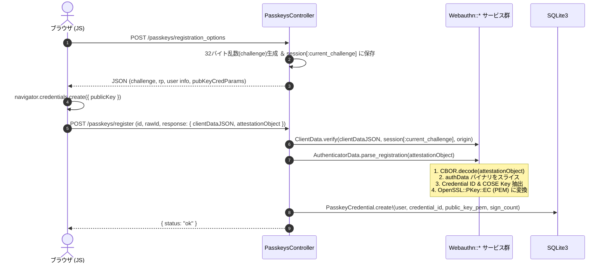
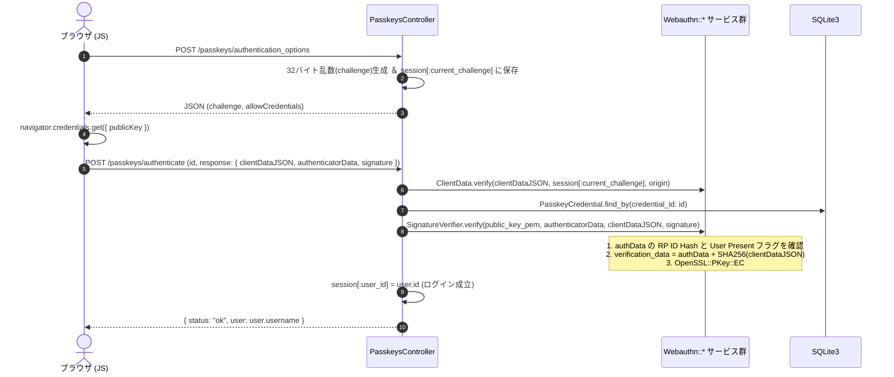

# 実装計画: Railsで構築するパスキー学習プロジェクト（低水準gemの組み合わせ）

## 目的・概要
ユーザー様のご要望に基づき、**Rails** をベースにプロジェクトを構築します。
ただし、「オールインワンのパスキーgem（例: `webauthn-ruby`, `devise-passkeys` 等）」は**使用せず**、WebAuthnの仕様（チャレンジ生成、バイナリパース、COSE公開鍵の復元、署名検証）を低レイヤのgem・ライブラリを組み合わせてRails上で自作・学習できる構成にします。

---

## 採用する技術スタックとライブラリ構成

| 用途 | 選定技術 / gem | 役割と選定理由 |
| :--- | :--- | :--- |
| **Webフレームワーク** | **Ruby on Rails 8** | MVC構造、Active Record（SQLite）、ルーティング、セッション管理を提供 |
| **暗号・電子署名検証** | `openssl` (Ruby標準) | ES256 (ECDSA P-256 + SHA-256) の署名検証・公開鍵復元（ASN.1 DER/PEM変換） |
| **バイナリパース (CBOR)** | `cbor` (gem) | `attestationObject` および COSE形式の公開鍵をデコードするために利用（WebAuthn専用gemではなく純粋なCBORパーサ） |
| **エンコード** | `base64` (Ruby標準) | WebAuthnで多用される `Base64URL` のエンコード・デコード |
| **DB** | SQLite3 | ユーザー情報、Passkeyクレデンシャル（credential_id, public_key_pem, sign_count）の永続化 |
| **フロントエンド** | Vanilla JavaScript + Hotwire/Stimulus (またはPlain JS) | ブラウザ標準の `navigator.credentials` APIを直接呼び出し、送受信データをインスペクターで可視化 |

> [!NOTE]
> オールインワンgemを使わないことで、以下のWebAuthnの「心臓部」を自前のRubyコード（サービス層 / モデル層）で完全に追えるようにします：
> 1. `clientDataJSON` のパースとチャレンジ・オリジン・タイプの検証
> 2. `authenticatorData` のバイナリ構造パース（RP ID Hash, フラグ, カウンタ, AAGUID, Credential ID, COSE Key）
> 3. COSE Key (P-256) のX/Y座標から `OpenSSL::PKey::EC` への変換
> 4. `authenticatorData + SHA-256(clientDataJSON)` に対する電子署名（DER形式）の検証

---

## プロジェクト構成（Railsアプリケーション）

```
passkey-study/
├── Gemfile                      # rails, cbor, sqlite3, puma, etc. (webauthn gemは含めない)
├── app/
│   ├── controllers/
│   │   ├── passkeys_controller.rb   # 登録・認証のオプション発行 & 検証エンドポイント
│   │   └── home_controller.rb       # 学習・検証用のUI画面表示
│   ├── models/
│   │   ├── user.rb                  # ユーザーモデル
│   │   └── passkey_credential.rb    # クレデンシャル（credential_id, public_key_pem, sign_count）
│   ├── services/
│   │   └── webauthn/
│   │       ├── client_data.rb       # clientDataJSON のデコードと検証
│   │       ├── authenticator_data.rb# authenticatorData のバイナリパース（ビット演算・スライス）
│   │       ├── cose_key.rb          # COSE (CBOR) -> OpenSSL::PKey::EC 変換
│   │       └── signature_verifier.rb# OpenSSL を使った署名検証
│   └── views/
│       └── home/
│           └── index.html.erb       # 登録・認証フォーム ＆ ペイロード/バイナリの分解表示UI
└── test/
    └── services/webauthn/           # 実際のPayloadを使った単体テスト（学びを定着させるテストコード）
```

---

## WebAuthn処理フロー（Rails内での動作）

### 1. 登録フロー (Registration)


### 2. 認証フロー (Authentication)


---

## 変更・作成手順

1. **Railsプロジェクトの生成**:
   - `rails new . --force --skip-action-mailer --skip-action-mailbox --skip-action-text --skip-active-storage --skip-action-cable` 等の軽量構成で現ディレクトリにRailsアプリを展開。
   - `Gemfile` に `gem "cbor"` を追加して `bundle install`。
2. **モデル＆マイグレーション**:
   - `User` (username)
   - `PasskeyCredential` (user_id, external_id / credential_id, public_key_pem, sign_count)
3. **低水準 WebAuthn サービスクラスの作成**:
   - `app/services/webauthn/client_data.rb`
   - `app/services/webauthn/authenticator_data.rb`
   - `app/services/webauthn/cose_key.rb`
   - `app/services/webauthn/signature_verifier.rb`
4. **コントローラ & ルーティング**:
   - `PasskeysController` (options生成、登録検証、認証検証)
   - `HomeController` (UI表示)
5. **ビュー & フロントエンドJS**:
   - 登録・ログイン用のボタンと、WebAuthn APIから返ってきた生データ（Base64URL、バイナリ情報）を画面上で閲覧できるデバッグUI。
6. **テストコード**:
   - 正常系・異常系（改ざんされたチャレンジや署名）のテストを用意し、検証ロジックが意図通り動くか確認。

---

## 検証計画

### 1. 単体テスト (RSpec / Minitest)
- `rails test` を実行し、`authenticatorData` のパース、COSE Key の OpenSSL 変換、署名検証が正しく動作することを検証。
- 不正なチャレンジ、不一致なオリジン、改ざんされた署名でエラーになることを検証。

### 2. 手動・実機検証 (ブラウザ & Passkey)
- `bin/rails server -b 0.0.0.0` を起動。
- ブラウザでアクセスし、Passkey（Touch ID / Windows Hello / セキュリティキー / 仮想オーセンティケータ）を用いて登録および認証が完了することを確認。
- 画面上で送受信された生データ（`clientDataJSON` の中身、`authenticatorData` のバイト列内訳など）が分かりやすく表示されることを確認。
